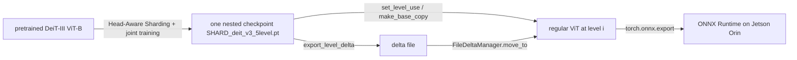
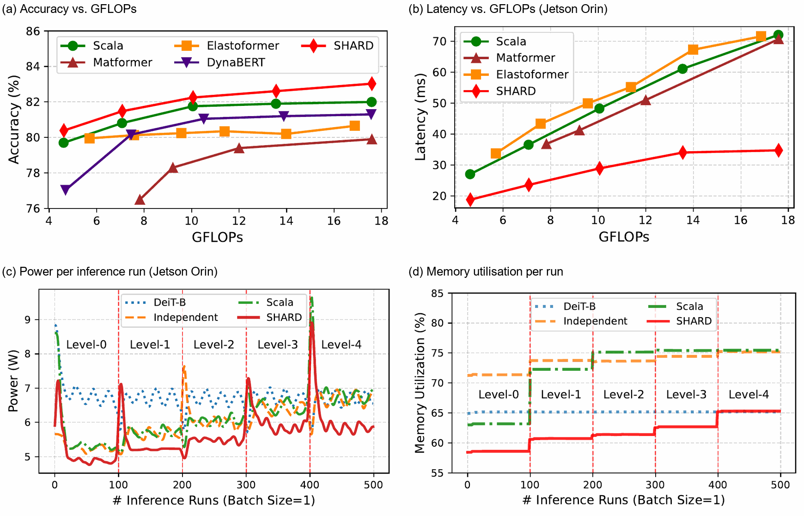

# SHARD: Sub-Transformer Harnessing for Adaptive Resource-Aware Deployment

Code for the ASP-DAC 2027 paper. Paper: **TODO: link to the paper**.

SHARD converts a *pretrained* ViT (DeiT-III ViT-B/16) into a hierarchy of nested sub-transformers ("levels") with **Head-Aware Sharding**
(all attention heads are kept, their embedding subspaces are scaled), trains all levels jointly, and ships a **Delta Runtime Manager (DRM)**
that moves a deployed model between levels by loading only the parameter deltas.

## Citation

**TODO: citation will be added once the paper link / final bibliographic details are available.**

```bibtex
@inproceedings{TODO_key,
  title     = {TODO},
  author    = {TODO},
  booktitle = {TODO},
  year      = {TODO}
}
```

## Method overview

* **Levels.** 5 levels, embedding D = 384 / 480 / 576 / 672 / 768, 12 heads each, 4.62-17.59 GFLOPs, 22.1-86.6 M parameters. Level *i* is a leading slice of every
  wider level's tensors ([docs/architecture.md](docs/architecture.md)).
* **Training.** Joint multi-level training with progressive distillation (`training/shard_trainer.py`, `python main.py run shard_deit_v3`).
* **DRM.** `export_level_delta` / `apply_level_delta_*` per module + `InMemoryDeltaManager` / `FileDeltaManager` ([docs/drm.md](docs/drm.md)).
* **Deployment.** Each level is a plain ViT (`make_base_copy()`), exportable to ONNX; the Jetson harness measures latency, power and energy per level.



## Repository structure

```
main.py            experiment launcher / training entry point (python main.py run shard_deit_v3)
config/            experiment registry (config/experiments.py), paths (environment-configurable)
training/          simple_trainer.py (standard trainer), shard_trainer.py (SHARD multi-level trainer)
shard_modules/     SHARD layers (nested slicing, level deltas)
networks/          models (shard_deit_v3 = final model), DRM (level_delta_utils.py)
utils/             shared helpers, data loading and augmentation (dataset.py, augment.py),
                   switching_harness/ (DRM verification and switching latency),
                   jetson_harness/ (Jetson preflight, per-level benchmark, energy)
segm/              ADE20K segmentation experiment
scripts/           ImageNet-level and retrieval evaluation
examples/          runnable examples
tests/             CPU unit and integration tests
docs/              architecture, DRM and reproduction guides, figures
checkpoints/       model weights (not in git, see below)
```

Run everything from the repository root (the top-level package names are used by saved artifacts and by `pytest.ini`).

## Requirements and installation

* Python >= 3.8, PyTorch >= 2.1. CPU is enough for the tests, the examples and the switching harness.
* Training needs Linux with NVIDIA GPUs (NCCL) and ImageNet-1k. Segmentation needs the older `mmcv`/`mmsegmentation` pins in `segm/requirements.txt`.
* `requirements.txt` lists all dependencies in one file; the Jetson-only packages are commented in it.

```bash
python -m venv .venv && source .venv/bin/activate
pip install -r requirements.txt
python -m pytest -q
```

## Checkpoints

Weights are hosted on SURFdrive: <https://surfdrive.surf.nl/s/RpMqw3sSd2p5SBg> (folder "SHARD checkpoints"). Place `SHARD_deit_v3_5level.pt` in `checkpoints/`
and check it with `sha256sum -c checkpoints/SHA256SUMS`. The share also holds the 7-level and low-FLOPS models and the segmentation snapshot; see
[`checkpoints/README.md`](checkpoints/README.md).

## Quick start

```python
import torch
from utils.switching_harness import common

cfg = common.paper_config("shard_deit_v3")                                  # 5 levels, networks.shard_deit_v3.ViTConfig_v3
model = common.build_shard_model(cfg, "checkpoints/SHARD_deit_v3_5level.pt")  # strict state-dict load (random init if None)
model.set_level_use(2)                                                      # 0 = smallest ... 4 = full width
logits = model(torch.randn(1, 3, 224, 224))                                 # (1, 1000)
```

Runnable examples (examples B and C also work without a checkpoint with `--tiny`):

| Example | Command |
|---|---|
| A. load and run | `python examples/01_load_and_run.py --checkpoint checkpoints/SHARD_deit_v3_5level.pt --level 4 [--image x.jpg]` |
| B. compare levels | `python examples/02_select_levels.py --checkpoint checkpoints/SHARD_deit_v3_5level.pt [--latency]` |
| C. runtime switching | `python examples/03_runtime_switching.py --checkpoint checkpoints/SHARD_deit_v3_5level.pt --targets 4 2 0 3` |
| D. Jetson evaluation | `examples/04_jetson_evaluation.sh` (on a Jetson) |

## Level selection and switching

`model.set_level_use(i)` selects a nested sub-transformer of the SHARD model (no copy). `make_base_copy()` yields a regular model of that level for deployment.
Switching a deployed regular model uses the DRM:

```python
from networks import level_delta_utils as delta
with delta.file_delta_manager("model.delta", cfg.create_base_config(0).no_prebuilt()) as manager:
    model = manager.move_to(4)        # in place, applies the deltas of levels 1..4
    model = manager.move_to(1)
```

## Results

All numbers below are the ones reported in the paper.



### Levels

| Level | Embedding D | GFLOPs | Parameters (M) | Top-1 accuracy (%) |
|---|---|---|---|---|
| 0 | 384 | 4.62 | 22.05 | 80.39 |
| 1 | 480 | 7.08 | 34.20 | 81.48 |
| 2 | 576 | 10.06 | 49.00 | 82.25 |
| 3 | 672 | 13.56 | 66.46 | 82.61 |
| 4 | 768 | 17.59 | 86.57 | 83.03 |

### Energy per inference on Jetson Orin (15 W, mean ± std over 100 runs per level)

| Approach | Level 0 | Level 1 | Level 2 | Level 3 | Level 4 | Average |
|---|---|---|---|---|---|---|
| Original (DeiT-B) | - | - | - | - | 485.3 ± 22.9 | 485.3 |
| Independent models | 150.2 ± 34.1 | 209.1 ± 8.6 | 301.2 ± 59.1 | 388.2 ± 15.4 | 475.7 ± 24.8 | 304.9 |
| Scala | 162.6 ± 47.1 | 210.0 ± 8.2 | 293.3 ± 12.4 | 401.8 ± 20.0 | 515.7 ± 98.8 | 316.7 |
| **SHARD** | **103.2 ± 15.9** | **134.4 ± 15.7** | **164.3 ± 5.8** | **218.5 ± 34.0** | **225.2 ± 36.5** | **169.1** |

SHARD saves 65.1 % energy per inference on average and up to 78.7 % relative to the original model (energy in mJ).

### Switching latency between levels

| Approach | Up-switch | Down-switch | Mean |
|---|---|---|---|
| Independent models (full model load) | 455.7 ms | 422.4 ms | 439.1 ms |
| SHARD (delta manager) | 32.8 ms | 6.9 ms | 19.9 ms |

## Jetson harness

[`utils/jetson_harness/`](utils/jetson_harness/README.md): `preflight.sh` -> `run_energy_benchmark.sh` -> `run_switching_benchmark.sh` -> `collect_results.sh`.

## Reproducing the paper

[`docs/reproduction.md`](docs/reproduction.md) lists every experiment with its code, configuration, checkpoint and command.

## Tests

```bash
python -m pytest -q                              # CPU test suite (GPU and dataset tests are skipped automatically)
python -m utils.switching_harness verify         # correctness of runtime switching (tiny model)
```

## Troubleshooting

| Problem | Fix |
|---|---|
| `ModuleNotFoundError: networks` | run from the repository root, or set `PYTHONPATH=.` |
| `Error(s) in loading state_dict` | use the configuration that matches the checkpoint (`scripts/evaluate_imagenet_levels.py --preset`) |
| timm tries to download weights | build models with `.no_prebuilt()` (all helper functions here do) |
| weights-only unpickling errors | delta files and level models contain pickled objects; the code passes the required options and registers the safe globals |
| Jetson problems | [utils/jetson_harness/README.md](utils/jetson_harness/README.md#troubleshooting) |

## License

Apache-2.0, see [`LICENSE`](LICENSE). Model weights have separate terms (see [`checkpoints/README.md`](checkpoints/README.md)).

## Contact

Open an issue on the GitHub repository. Author contact details will be added with the paper link.
