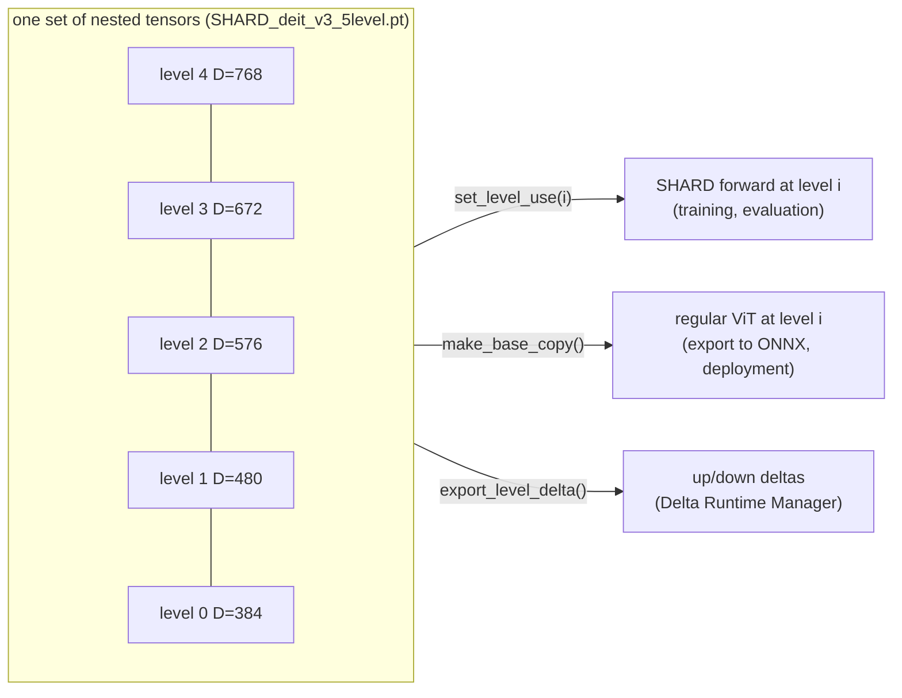

# Architecture: SHARD models and nested weights

SHARD turns one pretrained ViT into a hierarchy of **nested sub-transformers** ("levels") that share one set of
parameter tensors.

| Name | Meaning in this repository |
|---|---|
| `shard_modules/` | SHARD layers: ordinary layers (`Linear`, attention, `LayerNorm`, `Conv2d`, tokens, ...) that hold the full-width tensors and can run at any level |
| `networks/shard_deit_v3.py` (`ViTConfig_v3`) | **the final SHARD model** (DeiT-III ViT-B/16 with LayerScale and stochastic depth) - the released checkpoints `SHARD_deit_v3_*.pt` are state dicts of this class |
| `networks/shard_vit.py` (`ViTConfig`) | the earlier torchvision-style SHARD ViT (same level structure, no LayerScale); the Jetson benchmark experiments use it by default |
| `networks/shard_resnet.py`, `shard_vgg.py` | CNN versions, showing that levels/deltas are not ViT specific |
| `networks/level_delta_utils.py` | the Delta Runtime Manager ([drm.md](drm.md)) |

## Levels

A *level* is one operating point. For the paper's model (`utils.switching_harness.common.paper_config("shard_deit_v3")`):

| level | embedding D | heads | head size | MLP dim | params (regular model) | GFLOPs |
|---|---|---|---|---|---|---|
| 0 | 384 | 12 | 32 | 1536 | 22.06 M | 4.62 |
| 1 | 480 | 12 | 40 | 1920 | 34.21 M | 7.08 |
| 2 | 576 | 12 | 48 | 2304 | 49.01 M | 10.06 |
| 3 | 672 | 12 | 56 | 2688 | 66.47 M | 13.56 |
| 4 | 768 | 12 | 64 | 3072 | 86.59 M | 17.59 |

(parameter and GFLOP counts as printed by `examples/02_select_levels.py`.)

All levels keep **all 12 heads**; Head-Aware Sharding shrinks every head's size and the shared embedding width
instead of dropping heads. Level *i* is a strict prefix slice of level *j > i*:

- patch embedding, class token, positional embedding, LayerNorm and LayerScale vectors: leading `D_i` entries;
- QKV projection: for every head, the first `h_i` channels of its Q/K/V block and the first `D_i` input channels
  (`shard_modules/selfattention.py`);
- MLP: top-left blocks `W1[:M_i, :D_i]`, `W2[:D_i, :M_i]`, biases `b1[:M_i]`, `b2[:D_i]` (`shard_modules/linear.py`);
- classifier head: `LinearSelect` (a separate head per level on the level's embedding width).

Pretrained weights are *not* re-ordered (`head_permutation="none"` in the released config); `networks/head_ablations.py`
implements the importance/random head orderings used for the ablation.

## SHARD modules

`shard_modules.Module` (`shard_modules/module.py`) is a `torch.nn.Module` with

| method | purpose |
|---|---|
| `set_level_use(level)` / `current_level()` / `max_level()` | select the active nested slice (no data is copied) |
| `make_base_copy()` | build the equivalent *regular* module at the current level (slices copied/viewed into a standard `nn.Linear`, `nn.MultiheadAttention`, ...) |
| `copy_to_base(dest)` / `load_from_base(src)` | move weights between SHARD and regular modules |
| `export_level_delta()` | `(DownDelta, UpDelta)` describing how a regular module at level *i-1* becomes level *i* and back |
| `apply_level_delta_down/up(module, delta)` (static) | apply a delta to a regular module in place |

`networks/shard_model.py::ShardModel` applies this recursively to whole networks; `ShardModelConfig` creates the model
(`make_model()`), the config of the regular counterpart (`create_base_config(level)`) and strips pretrained loading (`no_prebuilt()`).

## Training (paper Sec. 3.2, Algorithm 1)

`training/shard_trainer.py::ShardDistillTrainer` (PyTorch Lightning, manual optimisation) trains the levels in each step on the same
mini-batch; the accumulated gradients update the shared parameters once. The levels of a step are chosen by `training_mode`:
`'sampled'` (default, `num_sampled = 4`) trains the widest level, level 0 and `num_sampled - 2` levels drawn at random from the levels
in between; `'simple'` (paper Algorithm 1) trains every level from the widest to level 0.

* the widest level is trained against the (mixup/cutmix) labels through `DistillationLoss`;
* with `transfer_type='progressive'` (the default of all `shard_deit_v3*` experiments) every narrower level *i* is distilled from the
  output of the next wider level *i+1* (KL divergence on the soft targets) plus a cross-entropy term (`ce_coefficient`);
  `transfer_type='US'` distils every level from the widest one instead.

Settings of the paper's model are in `config/experiments.py` (`shard_deit_v3`): LAMB, lr 5e-4, weight decay 0.05, cosine schedule with
5 warm-up epochs, 100 epochs, batch size 256, bf16 mixed precision, `drop_path_rate=0.1`, mixup/cutmix from `utils.mixup_fn`.
`DistillationLoss` can add a pretrained-teacher term for the widest level (`distillation_type`, teacher = timm
`deit3_base_patch16_224.fb_in22k_ft_in1k`); the default recipe has it switched off (`distillation_type='none'`).

Experiments: `python main.py list all`; the ablation entries (`shard_deit_v3_ablation_{random,importance,naive}`) use 4/6/8/10/12
heads of size 64 with the pretrained heads kept in their original order (`naive`), in random order (`random`) or sorted by importance
(`importance`, `networks/head_ablations.py`).
